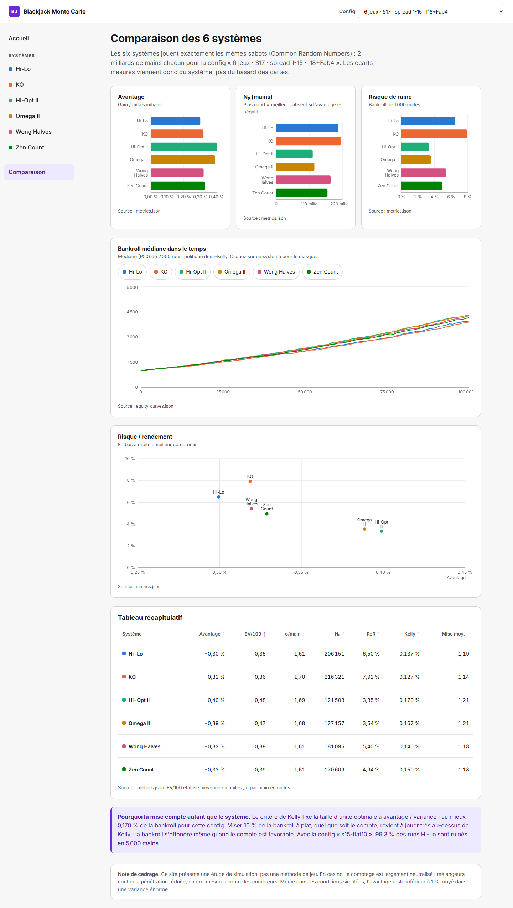

# Black-Jack-Monte-Carlo

Simulateur Monte Carlo en Rust qui compare six systèmes de comptage au blackjack sur exactement les mêmes sabots, et dashboard web statique pour explorer les résultats.

*[English version below](#english)*



## Fonctionnalités

- **Six systèmes :** Hi-Lo, KO, Hi-Opt II, Omega II, Wong Halves et Zen Count, avec Illustrious 18 et Fab 4 mis à l'échelle de chaque système et side-count des As pour Hi-Opt II et Omega II.
- **Common Random Numbers :** les six systèmes jouent les mêmes sabots. Les écarts mesurés viennent du système, pas du hasard des cartes.
- **Résultats reproductibles :** une seed maître, et un résultat identique au bit près quel que soit le nombre de threads.
- **Deux modèles de pari :** des unités sur une bankroll infinie (avantage, N₀, risque de ruine, fraction de Kelly) et une bankroll finie (demi-Kelly ou 10 % à plat, courbes P5–P95, drawdowns).
- **Dashboard :** une page-rapport par système avec exemple de comptage calculé, une page de comparaison avec tableau triable, en français et lisible sur mobile.

## Résultats

Config « 6 jeux · S17 · spread 1-15 · I18+Fab4 », 2 milliards de mains par système (2 000 runs × 1 000 000 mains). Le risque de ruine est calculé pour une bankroll de 1 000 unités.

| Système | Avantage | N₀ (mains) | Risque de ruine |
| --- | --- | --- | --- |
| Hi-Lo | +0,30 % | 206 151 | 6,50 % |
| KO | +0,32 % | 216 321 | 7,92 % |
| Hi-Opt II | +0,40 % | 121 503 | 3,35 % |
| Omega II | +0,39 % | 127 157 | 3,54 % |
| Wong Halves | +0,32 % | 181 095 | 5,40 % |
| Zen Count | +0,33 % | 170 609 | 4,94 % |

En basic strategy seule, mise plate, l'avantage est de −0,355 %. Le lancement complet a simulé 28,4 milliards de mains en 642 s sur 8 threads, soit environ 44 millions de mains par seconde.

La validation (basic strategy contre Wizard of Odds, Hi-Lo 1-5 et 1-15) et ses écarts sont détaillés dans [docs/METHODOLOGIE.md](docs/METHODOLOGIE.md).

## Architecture

| Élément | Rôle |
| --- | --- |
| `engine/` | Bibliothèque Rust : sabot, basic strategy, compteurs, déviations, modèles de pari, simulation parallèle (`rayon`) |
| `cli/` | Binaire batch : lit une config TOML et écrit les tables en Parquet (`data/`) et en JSON (`dashboard/public/data/`) |
| `configs/` | `quick.toml` (CI, quelques secondes) et `full.toml` (lancement publié) |
| `dashboard/` | React, TypeScript, Vite, React Router et Recharts. Site statique qui lit les JSON sans rien recalculer |
| `scripts/screenshots.mjs` | Captures Playwright du dashboard |

## Lancer le projet

```bash
cargo run --release -p cli -- configs/quick.toml
```

```bash
cargo run --release -p cli -- configs/full.toml
```

Le lancement complet prend une dizaine de minutes sur 8 threads et régénère `dashboard/public/data/`.

```bash
cd dashboard
npm install
npm run dev
```

## Tests

```bash
cargo test
cargo test --release -- --ignored --nocapture
```

La seconde commande lance les validations longues (plusieurs dizaines de millions de mains).

```bash
cd dashboard
npm test
```

## Déployer sur Vercel

Importez le dépôt dans Vercel et choisissez `dashboard` comme dossier racine (Root Directory). Le framework Vite est détecté automatiquement, et `vercel.json` renvoie toutes les routes vers `index.html`.

## Avertissement

Ce projet est une étude de simulation, pas une méthode de jeu. En casino, le comptage est largement neutralisé, et même dans les conditions simulées l'avantage reste faible face à une variance énorme.

## Licence

MIT, voir [LICENSE](LICENSE).

---

## English

A Monte Carlo simulator written in Rust that compares six blackjack card counting systems on exactly the same shoes, plus a static web dashboard to explore the results. The dashboard is in French.

### Features

- **Six systems:** Hi-Lo, KO, Hi-Opt II, Omega II, Wong Halves and Zen Count. The Illustrious 18 and Fab 4 indices are scaled to each system, and Hi-Opt II and Omega II use an ace side count.
- **Common Random Numbers:** all six systems play the same shoes, so measured differences come from the system, not from card luck.
- **Reproducible:** one master seed, with bit-identical results whatever the thread count.
- **Two betting models:**
  - unit bets with an infinite bankroll: advantage, N₀, risk of ruin and Kelly fraction;
  - a finite bankroll, with half-Kelly or 10 % flat bets, P5–P95 curves and drawdowns.
- **Dashboard:** one report page per system with a computed counting example, and a comparison page with a sortable table. It is mobile-friendly.

### Results

Config "6 decks · S17 · 1-15 spread · I18+Fab4", 2 billion hands per system (2,000 runs × 1,000,000 hands). Risk of ruin is for a 1,000-unit bankroll.

| System | Advantage | N₀ (hands) | Risk of ruin |
| --- | --- | --- | --- |
| Hi-Lo | +0.30 % | 206,151 | 6.50 % |
| KO | +0.32 % | 216,321 | 7.92 % |
| Hi-Opt II | +0.40 % | 121,503 | 3.35 % |
| Omega II | +0.39 % | 127,157 | 3.54 % |
| Wong Halves | +0.32 % | 181,095 | 5.40 % |
| Zen Count | +0.33 % | 170,609 | 4.94 % |

Flat-betting basic strategy alone gives −0.355 %. The full run simulated 28.4 billion hands in 642 s on 8 threads, about 44 million hands per second. Validation against Wizard of Odds and the known gaps are covered in [docs/METHODOLOGIE.md](docs/METHODOLOGIE.md), which is in French.

### Run it

```bash
cargo run --release -p cli -- configs/quick.toml
cargo run --release -p cli -- configs/full.toml
```

```bash
cd dashboard
npm install
npm run dev
```

### Tests

```bash
cargo test
cargo test --release -- --ignored --nocapture
cd dashboard && npm test
```

### Deploy to Vercel

Import the repository into Vercel and set the Root Directory to `dashboard`. Vite is detected automatically, and `vercel.json` rewrites every route to `index.html`.

### Disclaimer

This is a simulation study, not a way to play. Casinos largely neutralize counting, and even under the simulated conditions the edge is small next to a huge variance.

### License

MIT, see [LICENSE](LICENSE).
